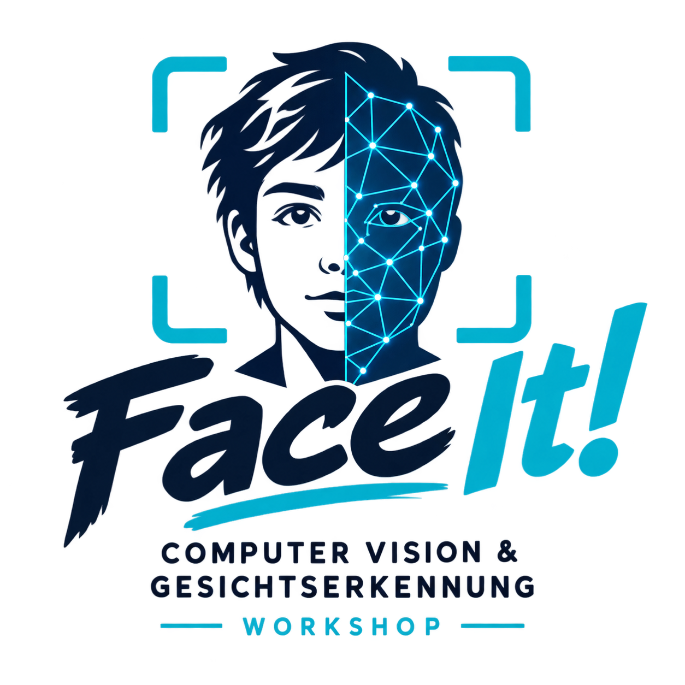

<p align="center">
  
</p>

# Face it!

**Ein Workshop zu Computer Vision am Beispiel der Gesichtserkennung.**
Für die Differenzierungskurse Mathematik der Klasse 10 am
[Städtischen Albert-Schweitzer-Gymnasium Plettenberg](https://www.asg-plettenberg.de/).
Ohne Programmiervorkenntnisse. 3,5 Stunden. Zwei Python-Pakete, keine Cloud,
kein Konto – während des Workshops ist keine Internetverbindung nötig.

> Du entsperrst dein Handy jeden Tag mit dem Gesicht.
> Heute baust du das selbst nach. Und dann brichst du es.

## Worum es geht

Der Workshop zerlegt Gesichtserkennung in vier Schritte, die die Schüler:innen
jeweils selbst am Rechner nachvollziehen – jeder mit genau einem Aha-Moment:

| Station | Was passiert | Der Kippmoment |
|---|---|---|
| **1 · Pixel** | Das eigene Gesicht wird zu einem 16×16-Zahlengitter und auf Papier ausgemalt | „Der Computer sieht Zahlen, kein Gesicht" |
| **2 · Faltung** | Ein 3×3-Kernel wird von Hand gerechnet, dann live auf der Webcam | „Wir waren gerade ein Convolutional Layer" |
| **3 · Detektion** | Die Erkennung wird ausgetrickst: Poster, Zeichnung, Handy-Foto, Steckdose | „Erkennung ist Statistik, nicht Wahrheit" |
| **4 · Erkennung** | Gesicht → 128 Zahlen → Ähnlichkeit → eigene Face-ID mit Schwellenwert-Regler | „Ich bin ein Punkt im Raum, und Sicherheit ist ein Regler" |

Zum Abschluss greifen die Gruppen ihre eigenen Systeme an (Foto vor die Kamera,
Schwellenwert verstellen, Referenzdatei austauschen), messen die Fehlerarten an
den Daten der Klasse und diskutieren, wem das eigene Gesicht eigentlich gehört.

## Schnellstart

```bash
uv sync                       # einmal, mit Internetverbindung
uv run code/00_check.py       # sieht man sich selbst? Dann kann es losgehen.
```

Unter Windows genügt ein Doppelklick auf **`start.bat`** – das erledigt `uv sync`
und öffnet ein Menü mit allen Stationen. Wer `uv` noch nicht hat:
[docs/02_technik_setup.md](docs/02_technik_setup.md).

## Die Programme

```bash
uv run code/00_check.py                # Startcheck: läuft die Kamera?
uv run code/01_pixel.py                # Station 1: Bild als Zahlentabelle
uv run code/02_filter.py               # Station 2: Kernel live auf der Webcam
uv run code/03_detect.py               # Station 3: Gesichter finden und austricksen
uv run code/03b_landmarks.py           # Kür: 68 Punkte als Dreiecksnetz
uv run code/04a_embedding.py           # Station 4a: dein Gesicht als 128 Zahlen
uv run code/04b_vergleich.py           # Station 4b: zwei Gesichter vergleichen
uv run code/04c_faceid.py              # Station 4c: eigene Handy-Entsperrung
uv run code/05_bias.py                 # Station 5: Fehlerarten und Bias
uv run code/99_cleanup.py              # Abschluss: alle Gesichtsdaten löschen
```

Fünf **Advanced**-Programme für schnelle Gruppen und zum Weiterbasteln zu Hause:

```bash
uv run code/90_anwesenheit.py          # Anwesenheitsliste für die Tischgruppe
uv run code/91_gesichtsraum.py         # der 128-dim. Raum als 2D-Schatten (PCA)
uv run code/92_fehlerkurve.py          # FAR und FRR als Kurven, mit Kreuzungspunkt
uv run code/93_durchschnitt.py         # Gesichter mischen und mitteln
uv run code/94_kernel_labor.py         # eigener Kernel mit neun Schiebereglern
```

## Für die Lehrkraft

| Dokument | Inhalt |
|---|---|
| [docs/00_konzept.md](docs/00_konzept.md) | Didaktisches Konzept, Lernziele, die vier Aha-Momente, Datenschutz, Differenzierung |
| [docs/01_agenda.md](docs/01_agenda.md) | Minutengenauer Ablaufplan mit Choreografie und Notfallplan |
| [docs/02_technik_setup.md](docs/02_technik_setup.md) | Installation, Freigaben für die Schul-IT, Checkliste, Fehlerbehebung |
| [docs/03_loesungen.md](docs/03_loesungen.md) | Alle Lösungen, erwartete Zahlenwerte und Antworten – für schnelle Hilfe bei feststeckenden Gruppen |
| [docs/99_glossar.md](docs/99_glossar.md) | Alle Begriffe in Alltagssprache, von Pixel bis EU AI Act |

Vorbereitung (einmal, mit Internetverbindung):

```bash
uv run code/tools/portraits_holen.py    # Ersatzportraits für Opt-out
uv run code/tools/handout_faltung.py    # Arbeitsblatt B samt Lösung
uv sync --extra werkzeuge               # nur wenn du den QR-Code brauchst
uv run code/tools/qr_erzeugen.py        # QR-Code für die Abschlussfolie

uv run code/tools/landmark_modell_holen.py   # nur für den Beamer (Station 3b)
```

Material zum Ausdrucken (HTML, im Browser öffnen und `Strg+P`):

- `material/handouts/handout_A_laufzettel.html` – Laufzettel für alle Stationen, 2 Seiten
- `material/handouts/handout_B_faltung.html` – Faltung von Hand, 2 Seiten mit ausgerechnetem Beispiel (plus Lösungsblatt)
- `material/handouts/handout_C_bingo.html` – Experimente-Bingo für Station 3
- `material/handouts/handout_D_hack.html` – Punktekarte für die Hack-Challenge
- `material/handouts/handout_E_ampelkarte.html` – Ampelkarte grün/rot zum Hochhalten, Fehlerhilfe innen
- `material/handouts/handout_F_testmuster.html` – Testmuster mit vier Kantenrichtungen für die Kernel-Challenge
- `material/elternbrief_und_einwilligung.html` – Elternbrief und Einwilligung
- `material/folien/index.html` – die fünf Folien (Pfeiltasten, `F` für Vollbild)

## Aufbau des Repositories

```
code/         Die Stationen 00 bis 99, faceit.py als gemeinsames Hilfsmodul
code/tools/   Werkzeuge für die Vorbereitung (nicht für den Workshop)
docs/         Konzept, Ablaufplan, Technik-Setup, Glossar
material/     Handouts, Folien, Elternbrief und Einwilligung
models/       YuNet und SFace als ONNX-Dateien, offline nutzbar
data/         Aufnahmen des Workshops (wird am Ende geleert)
images/       Logo
```

## Technik

| Baustein | Wofür |
|---|---|
| `opencv-contrib-python` 4.x | Kamera, Bildverarbeitung, Haar-Cascade, Landmarks |
| `numpy` | Rechnen mit Zahlengittern |
| **YuNet** (`models/yunet.onnx`, 0,2 MB) | findet Gesichter, markiert fünf Punkte |
| **SFace** (`models/sface.onnx`, 38 MB) | rechnet ein Gesicht in 128 Zahlen um |
| **LBF-Modell** (54 MB, nicht im Repo) | nur für die optionale Station 3b: 68 Landmarks, daraus ein Delaunay-Netz |

Bewusst **kein** dlib, kein `face_recognition`, kein Colab und kein MediaPipe:
dlib braucht auf Windows einen C++-Compiler und scheitert in Schulnetzen
regelmäßig, WLAN in Klassenstärke ist die häufigste Ursache für einen
gescheiterten Workshop, und MediaPipe hat die API zum Zeichnen des Netzes
entfernt und würde eine zweite OpenCV-Version mitbringen. Alles Nötige steckt in
OpenCV selbst.

Fällt an einem Rechner die Webcam aus, laufen alle Stationen im Notfall-Modus mit
einem gespeicherten Bild weiter (`FACEIT_KAMERA`, siehe Technik-Setup).

## Datenschutz

Der Workshop verarbeitet biometrische Daten von Minderjährigen – und macht genau
das zum Lerninhalt:

- Alle Aufnahmen bleiben **lokal** in `data/`. Kein Upload, kein Netzwerkzugriff.
- Vorab wird eine Einwilligung eingeholt (Vorlage in `material/`).
- Wer nicht fotografiert werden möchte, arbeitet **ohne Begründung** mit freien
  Portraitfotos und macht jede Aufgabe genauso mit.
- Am Ende löschen alle gemeinsam ihre Daten mit `code/99_cleanup.py`.
  Datensparsamkeit wird vorgeführt, nicht behauptet.

## Lizenz

Dokumentation und Material: **CC BY-NC 4.0** · Code: **MIT** (siehe `LICENSE`)

Die Modelle stammen aus dem [OpenCV Model Zoo](https://github.com/opencv/opencv_zoo)
und stehen unter ihren jeweiligen Lizenzen. Die Portraitfotos in `data/beispiele/`
werden lokal geladen und sind nicht Teil dieses Repositories; ihre Urheber und
Lizenzen stehen in `data/beispiele/CREDITS.md`.
